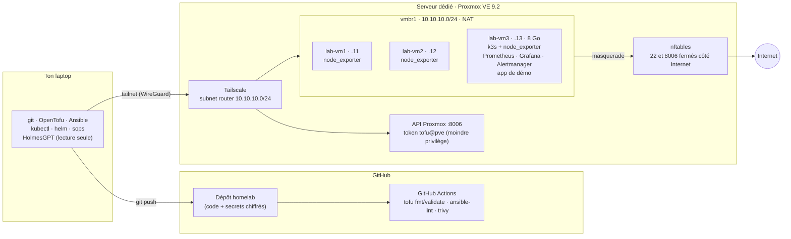

# Homelab du week-end

Un vrai socle d'infra en un week-end, entièrement en code : un serveur dédié sous **Proxmox VE**, 3 VMs créées par **OpenTofu**, configurées par **Ansible**, un **k3s** avec **Prometheus / Grafana / Alertmanager**, une app que tu casses volontairement, une **IA en lecture seule** pour t'aider à diagnostiquer, et une **CI GitHub Actions**. Dimanche soir, tu détruis tout. Le week-end suivant, tu reconstruis en quelques commandes.

Pour qui : admins sys, ingénieurs système et devs qui veulent passer au DevOps / SRE sans avoir jamais fait d'Infrastructure as Code.

## Ce que tu obtiens

- Un hôte Proxmox **sans aucun port ouvert sur Internet** : SSH et l'interface web passent par Tailscale.
- 3 VMs Debian 13 décrites dans `opentofu/`, reconstruites à l'identique par `tofu destroy && tofu apply`.
- Des VMs durcies (SSH par clé, pas de root, mises à jour de sécurité automatiques) avec node_exporter, par des rôles Ansible idempotents.
- Un cluster k3s joignable uniquement via Tailscale, une stack de monitoring branchée sur tes VMs, une alerte que tu déclenches toi-même.
- Une méthode de diagnostic éprouvée sur 3 pannes classiques (ImagePullBackOff, OOMKilled, variable manquante), puis vérifiée face à HolmesGPT.
- Des secrets chiffrés (sops + age), un state hors du dépôt, une CI qui vérifie chaque push.

## Architecture



## Budget (vérifié le 25/11/2026)

| Poste | Coût |
|---|---|
| Hetzner Server Auction (≥ 32 Go, NVMe) | pas de frais de mise en service, facturation à l'heure plafonnée au mois. L'enchère affichait « à partir de 80,70 € HT/mois » : ≈ 0,11 € HT/h, **≈ 6 € HT pour un week-end de 55 h** |
| ou OVHcloud Kimsufi KS-B (32 Go, SSD SATA 120 Go) | 9,99 € HT/mois + 9,99 € HT d'installation, **au mois** (stock très variable) |
| ou un vieux PC à la maison (32 Go, VT-x/AMD-V) | 0 € (hors électricité) |
| Tailscale Personal | 0 € |
| GitHub (dépôt + Actions sur dépôt public) | 0 € |
| Clé d'API IA | quelques centimes à quelques euros, **plafonnée** par toi |

Les prix bougent (Hetzner a augmenté ses tarifs plusieurs fois en 2026). Regarde le prix affiché au moment de commander.

## Prérequis

- Un compte Hetzner ou OVHcloud **validé** (lance la vérification vendredi).
- Linux, macOS ou Windows avec WSL2.
- Les outils de [vendredi](docs/00-vendredi-preparation.md) : git, OpenTofu, Ansible (Python ≥ 3.13), kubectl, helm, sops, age.
- Savoir utiliser SSH et un terminal. Aucune expérience d'IaC nécessaire.

## Le parcours

**Vendredi soir (~20 min)** : [préparation](docs/00-vendredi-preparation.md)

**Samedi : le socle**

1. [Un serveur dédié, pas un VPS](docs/01-serveur-dedie.md)
2. [Installer Proxmox VE 9.2](docs/02-installer-proxmox.md)
3. [Verrouiller la porte : Tailscale, SSH par clé, pare-feu](docs/03-verrouiller-acces.md)
4. [Le réseau des VMs : vmbr1 + NAT + route Tailscale](docs/04-reseau-vms-nat.md)
5. [Le template Debian 13 (image generic + qemu-guest-agent)](docs/05-template-debian.md)
6. [Un utilisateur et un token d'API pour OpenTofu](docs/06-utilisateur-token-api.md)
7. [3 VMs avec OpenTofu (bpg/proxmox)](docs/07-opentofu-vms.md)
8. [Ansible : durcissement, mises à jour, node_exporter](docs/08-ansible-configuration.md)
9. [Tout dans Git, le state dehors, les secrets chiffrés](docs/09-git-state-secrets.md) + le test `destroy` / `apply`

**Dimanche : Kubernetes, observabilité, IA**

1. [k3s sur la VM 3, joignable via Tailscale](docs/10-k3s.md)
2. [Prometheus, Grafana, Alertmanager + une alerte déclenchée](docs/11-observabilite.md)
3. [Déployer une app, la casser 3 fois](docs/12-casser-une-app.md)
4. [L'IA en lecture seule : HolmesGPT (ou K8sGPT)](docs/13-ia-lecture-seule.md)
5. [Une CI minimale avec GitHub Actions](docs/14-ci-github-actions.md)
6. [Dimanche soir : on détruit, on résilie, on publie](docs/15-nettoyage-dimanche-soir.md)

En cas de souci : [FAQ et dépannage](docs/faq-depannage.md). Pour la suite : [aller plus loin](docs/aller-plus-loin.md).

## Arborescence

```text
.
├── host/                  # à copier sur l'hôte Proxmox
│   ├── 00-check-virtualization.sh
│   ├── install-proxmox-on-debian13.sh   # Hetzner : Debian 13 -> Proxmox (wiki officiel)
│   ├── tailscale-setup.sh               # tailnet + subnet router
│   ├── create-template.sh               # template Debian 13 generic + qemu-guest-agent
│   ├── create-tofu-user.sh              # rôle, utilisateur, token (moindre privilège)
│   ├── network/                         # interfaces Hetzner / OVH, sysctl
│   ├── firewall/                        # nftables + service systemd + retour arrière auto
│   └── ssh/                             # durcissement sshd de l'hôte
├── opentofu/              # les 3 VMs + l'inventaire Ansible généré
├── ansible/               # rôles common, node_exporter, k3s
├── kubernetes/
│   ├── monitoring/        # values kube-prometheus-stack + PrometheusRule
│   ├── demo-app/          # app saine + pannes/ (3 variantes cassées)
│   └── ai-readonly/       # RBAC lecture seule, kubeconfig à jeton court, config HolmesGPT
├── secrets/               # *.example en clair, *.enc.env chiffrés par sops
├── docs/                  # le pas-à-pas
├── .github/workflows/ci.yml
└── Makefile               # make help
```

## Les commandes du week-end (résumé)

```bash
make help
make init && make plan && make apply      # samedi : les VMs
make ansible                              # samedi : la configuration
make rebuild                              # le test : destroy + apply + ansible
make k3s monitoring alerts demo           # dimanche
make ai-readonly                          # kubeconfig lecture seule pour l'IA
make lint                                 # les vérifications de la CI, en local
make destroy                              # dimanche soir
```

## Nettoyage

Dimanche soir : `make destroy`, puis **résilie le serveur** dans Hetzner Robot ou chez OVH. Un serveur éteint est facturé comme un serveur allumé, tant qu'il est dans ton compte. Détails : [étape 15](docs/15-nettoyage-dimanche-soir.md).

## Sécurité : ce qu'il faut garder en tête

- **Aucun port public** : SSH et l'interface Proxmox ne passent que par Tailscale. Ferme-les avant de faire quoi que ce soit d'autre (étape 3).
- **Jamais `root@pam` dans le code** : OpenTofu utilise un token dont le rôle ne peut ni modifier le réseau de l'hôte, ni les utilisateurs, ni les droits.
- **Aucun secret en clair dans Git** : sops + age. Vérifie `git status` avant chaque commit. Un secret poussé se **révoque**, il ne s'efface pas.
- **Le state OpenTofu et les kubeconfigs restent hors du dépôt** (`.gitignore` les couvre, vérifie quand même).
- **Le kubeconfig k3s est cluster-admin** : ne le donne jamais à un outil d'IA. L'IA reçoit un kubeconfig lecture seule, sans accès aux Secrets, avec un jeton de 8 h.
- **La clé d'API IA a un plafond de dépenses**, dans un workspace / projet dédié.
- **Les actions GitHub sont épinglées par SHA** (incident trivy-action de mars 2026).
- Ce dépôt construit un **labo**. Pas de sauvegarde, pas de haute disponibilité, pas de données de production dessus.

## Versions (vérifié le 25/11/2026)

| Composant | Version | Où elle est fixée | Source |
|---|---|---|---|
| Proxmox VE | 9.2 (21/05/2026, Debian 13.6, noyau 7.0) | docs | [Roadmap Proxmox](https://pve.proxmox.com/wiki/Roadmap) |
| Debian cloud image | 13 trixie, `debian-13-generic-amd64.qcow2` (build `latest`, 20261123-2671) | `host/create-template.sh` (SHA-512 vérifié) | [cloud.debian.org](https://cloud.debian.org/images/cloud/trixie/latest/) |
| OpenTofu | 1.13.10 | `opentofu/versions.tf` (≥ 1.13), CI | [releases](https://github.com/opentofu/opentofu/releases) |
| Provider bpg/proxmox | 0.123.1 | `opentofu/versions.tf` + lock | [registry](https://search.opentofu.org/provider/bpg/proxmox) |
| Provider hashicorp/local | 2.9.1 | `opentofu/versions.tf` + lock | registry OpenTofu |
| ansible-core / ansible-lint | 2.22.0 / 26.11.1 | CI | PyPI |
| node_exporter | 1.13.1 | `ansible/inventory/group_vars/all.yml` | [releases](https://github.com/prometheus/node_exporter/releases) |
| k3s | v1.37.2+k3s1 (canal stable) | `ansible/inventory/group_vars/all.yml` | [canaux k3s](https://update.k3s.io/v1-release/channels) |
| kube-prometheus-stack | 93.11.0 (Operator v0.95.2, Prometheus v3.16.0, Alertmanager v0.35.1, Grafana 13.3.2) | `Makefile`, values | [chart](https://github.com/prometheus-community/helm-charts) |
| Helm | 4.3.2 (3.x compatible) | docs | [releases](https://github.com/helm/helm/releases) |
| kubectl | 1.37.2 | docs | kubernetes.io |
| HolmesGPT | 0.47.0 (Python 3.10–3.13) | docs | [PyPI](https://pypi.org/project/holmesgpt/) |
| K8sGPT | 0.4.41 | docs | [releases](https://github.com/k8sgpt-ai/k8sgpt/releases) |
| sops / age | 3.13.3 / 1.3.2 | docs | GitHub releases |
| Trivy / trivy-action | 0.76.2 / 0.36.0 (SHA épinglé) | CI | [trivy-action](https://github.com/aquasecurity/trivy-action) |
| actions/checkout, setup-python, setup-opentofu | v7.0.1, v7.1.0, v2.0.2 (SHA épinglés) | CI | GitHub |
| App de démo | `python:3.13.18-alpine3.24` | `kubernetes/demo-app/` | Docker Hub |

## Licence

[MIT](LICENSE) © 2026 Yohan Parent
